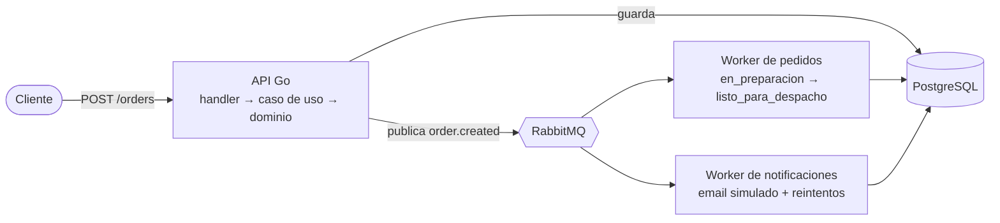
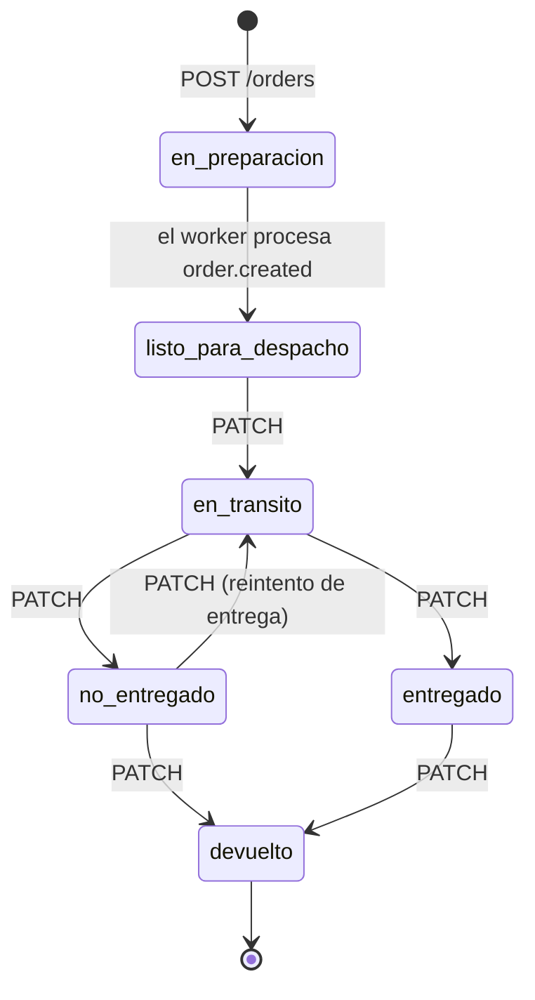

# EventFlow — API de pedidos en Go orientada a eventos

Solución al **EventFlow · Go Architecture Challenge**, construida sobre la semilla Go del bootcamp.

Una API recibe pedidos por HTTP y los guarda en PostgreSQL. Al crear un pedido, publica un evento `order.created` en
RabbitMQ. Un **worker** lo procesa en segundo plano: un consumidor **deja el pedido listo para despacho** y otro **envía un email
simulado**, con reintentos y cola de mensajes muertos (DLQ).



## Documentación

| Guía | Contenido |
|---|---|
| [Instalación](docs/01-instalacion.md) | Requisitos, instalación en Windows, macOS o Linux, primer arranque, problemas frecuentes |
| [Uso](docs/02-uso.md) | Crear y consultar pedidos (curl y PowerShell), idempotencia, logs, consola de RabbitMQ, configuración |
| [Pruebas](docs/03-pruebas.md) | Pruebas unitarias, de integración y de punta a punta; demostraciones de fallos; criterios RF → prueba |
| [Arquitectura](docs/04-arquitectura.md) | Diagramas: componentes, capas, secuencias, estados, base de datos y colas |
| [Postman](docs/05-postman.md) | Colección lista para importar, con pruebas automáticas para cada endpoint |
| [Sitio web](docs/06-sitio-web.md) | Sitio opcional para probar todo desde el navegador (hacer, buscar y seguir pedidos, y verificar cada requisito del PDF), y cómo revisar la base de datos local |

## Arranque rápido

Requisitos: Docker Desktop. Go 1.26+ solo hace falta para las pruebas.

```bash
docker compose up -d --build

curl -s -X POST localhost:3200/orders -H 'Content-Type: application/json' \
  -H 'Idempotency-Key: pedido-001' \
  -d '{"customer_id":"12345678-5","items":[{"sku":"SKU-1","quantity":2,"unit_price":8990}]}'
# -> 201 {"id":"...","status":"en_preparacion",...}

curl -s localhost:3200/orders/<id>     # un segundo después: "status":"listo_para_despacho"
docker compose logs -f api worker      # ver qué pasó

go test ./...                          # pruebas (no necesitan Docker)
```

Los comandos `curl` de arriba son para Git Bash, macOS o Linux. En PowerShell, los mismos ejemplos están en
[docs/02-uso.md](docs/02-uso.md). Paso a paso desde cero, con cómo verificar cada paso:
[docs/01-instalacion.md](docs/01-instalacion.md).

**Sitio web (opcional):** con el sistema levantado, `cd site && npm install && npm run dev` y abrir
<http://localhost:5173>. Permite hacer y buscar pedidos y ejecutar una prueba por cada requisito del PDF, sin usar la
terminal. No es parte de la API evaluada: es una herramienta para demostrarla ([guía](docs/06-sitio-web.md)).

## API

| Método | Ruta | Respuestas |
|---|---|---|
| `POST` | `/orders` (cabecera opcional `Idempotency-Key`) | `201` creado · `200` clave ya usada (devuelve el pedido original) · `400` datos inválidos · `413` cuerpo muy grande |
| `GET` | `/orders/{id}` | `200` · `400` id inválido · `404` no existe |
| `PATCH` | `/orders/{id}/status` con `{"status":"en_transito"}` | `200` actualizado · `400` estado desconocido · `404` no existe · `409` cambio no permitido |
| `GET` | `/health` · `/ready` · `/metrics` | Proceso vivo · base de datos disponible (`200`/`503`) · contadores |

### Cliente y estados del pedido

Definidos por el profesor en el canal del curso:

- **`customer_id` es el RUT del cliente.** Se valida el dígito verificador (módulo 11) y se guarda sin puntos:
  `12.345.678-5` → `12345678-5`. Un RUT inválido responde `400 ORDER_INVALID_CUSTOMER`.
- **Seis estados**, con reglas de qué cambios están permitidos. Cada respuesta trae `next_statuses` con los
  estados a los que se puede pasar desde el actual.



Cualquier otro cambio (por ejemplo, de `en_preparacion` directo a `entregado`) responde `409
ORDER_INVALID_TRANSITION` y el pedido no cambia. Las reglas están en `internal/orders/domain/status.go`.

Los errores siempre tienen el mismo formato y nunca muestran SQL ni contraseñas:

```json
{"error":{"type":"VALIDATION_ERROR","code":"ORDER_INVALID_QUANTITY","message":"items[0].quantity must be between 1 and 10000"},
 "request_id":"9e1519b3-…","timestamp":"2026-11-16T12:00:00Z"}
```

## Cómo se cubre cada nivel del desafío

| Nivel | Qué se implementó | Dónde |
|---|---|---|
| **1. API modular** (RF-01 a RF-08) | `POST /orders`, `GET /orders/{id}` y `PATCH /orders/{id}/status`; RUT validado; seis estados con reglas de transición; reglas de negocio en el dominio; PostgreSQL con migraciones versionadas; errores consistentes; configuración por variables de entorno; pruebas; docker compose | `internal/orders`, `migrations/`, `pkg/httputil`, `cmd/config` |
| **2. Confiabilidad** (RF-05, RF-10, RF-14) | `Idempotency-Key` con índice único en PostgreSQL; timeout por petición; límite de tamaño del cuerpo; apagado ordenado con SIGTERM | `internal/orders/infrastructure/postgres_repo.go`, `pkg/middleware`, `cmd/app/run.go` |
| **3. Event-driven** (RF-09 a RF-12) | Evento `order.created` en RabbitMQ; worker con dos consumidores; reintentos con espera creciente; DLQ; ACK solo al terminar; consumidores idempotentes | `pkg/rabbitmq`, `pkg/retry`, `pkg/events`, `cmd/worker` |
| **4. Operación** (RF-06, RF-13, RF-14) | Logs JSON con `request_id` que viaja dentro del evento; `/health`, `/ready` y `/metrics`; guía de ejecución local; `go vet` y `govulncheck` (dependencias sin vulnerabilidades conocidas en el código usado) | `pkg/logger`, `pkg/middleware`, `pkg/metrics`, `docs/` |

## Decisiones técnicas

1. **Se conserva la estructura de la semilla** (`domain → application → infrastructure / presentation`). Las reglas
   de negocio (`Order`) no conocen HTTP, SQL ni RabbitMQ, así que se prueban sin nada de eso.
2. **Interfaces solo donde hacen falta.** `OrderRepository` y `EventPublisher` las usan los casos de uso y en las
   pruebas se reemplazan por versiones en memoria. Se quitaron las de la semilla que no tenían un segundo uso
   (`database.Database`, `pubsub.PubSub`).
3. **Montos en pesos chilenos (`int64`).** El CLP no usa decimales, así que precios y totales son enteros
   (`8990` = $8.990) y no hay errores de redondeo. Cada respuesta trae `"currency": "CLP"`.
   **Estados y RUT en el dominio:** las transiciones permitidas son un mapa en `domain/status.go` y
   `Order.TransitionTo` es la única forma de cambiar el estado; el RUT se valida en `domain/rut.go`. El worker solo
   mueve pedidos que siguen `en_preparacion`, así que un evento que llega tarde no pisa un cambio manual.
4. **Idempotencia con la base de datos.** `idempotency_key` es `UNIQUE`. Si la clave ya existe, el
   `INSERT … ON CONFLICT DO NOTHING` no inserta nada y se devuelve el pedido original con `200`. Si llegan dos
   peticiones iguales al mismo tiempo, PostgreSQL hace esperar a la segunda, así que nunca se crean dos pedidos.
   Sin clave no hay protección (documentado).
5. **El evento se publica después de guardar el pedido**, con *publisher confirms*: RabbitMQ confirma que lo guardó.
   Si RabbitMQ no está disponible, el pedido queda guardado y se responde `201`, pero el evento se pierde y el pedido
   queda `en_preparacion`. Es la brecha que menciona el PDF. La solución sería el patrón *transactional outbox*, que el
   desafío marca como extensión opcional y queda como siguiente paso.
6. **Un worker con dos consumidores**, cada uno con su cola y su DLQ. Es un proceso aparte de la API para que un
   email lento no afecte las respuestas HTTP.
7. **Política de mensajes:** ACK solo después de terminar el trabajo. Si hay un error transitorio, se reintenta con
   espera creciente (0,5 s → 1 s → 2 s, 4 intentos). Si se agotan los intentos o el mensaje es inválido, va a la
   `.dlq` para investigar. Si llega un duplicado, se detecta y no se repite el efecto.
8. **Sin lógica de reconexión.** Si el worker pierde la conexión con RabbitMQ, termina con error y Docker lo
   reinicia (`restart: unless-stopped`). Es más simple y más fácil de explicar.
9. **Migraciones SQL embebidas en el binario**, aplicadas al arrancar y registradas en `schema_migrations`.
10. **Se quitaron de la semilla:** Swagger (el build de Docker fallaba porque `.dockerignore` excluía `docs/`), el
    driver de GCP Pub/Sub (el desafío pide un broker local) y el logger de colores (se reemplazó por JSON
    estructurado).

## Respuestas a las preguntas del desafío

**¿Qué ocurre si el cliente repite el POST porque no recibió respuesta?**
Si envía la misma `Idempotency-Key`, recibe `200` con el mismo pedido y no se crea otro, aunque los reintentos
lleguen al mismo tiempo. Sin la clave se crearía un pedido nuevo; por eso los clientes deben enviarla.

**¿Qué ocurre si el worker procesa el evento y falla antes de confirmar el mensaje?**
RabbitMQ no recibió el ACK, así que vuelve a entregar el mensaje. El worker de pedidos ve que el pedido ya está
`listo_para_despacho` y no hace nada. El de notificaciones ve en la tabla `notifications` que ese evento ya se notificó. En
ambos casos se hace ACK sin repetir el efecto (consumidores idempotentes).

**¿Cómo se evita perder el evento si la base de datos confirma el pedido pero el broker no está disponible?**
En esta versión **no se evita**: el pedido queda guardado en `en_preparacion`, el error queda en el log y la métrica
`events_publish_failed_total` sube. La solución es el *transactional outbox*: guardar el evento en una tabla dentro
de la misma transacción que el pedido y que un proceso aparte lo publique cuando RabbitMQ vuelva. Se dejó como
siguiente paso porque el PDF lo plantea como extensión, no como requisito.

**¿Qué debe ocurrir durante un apagado mientras se procesa un mensaje?**
El worker deja de recibir mensajes nuevos, termina el que está procesando y no empieza más reintentos. Lo que no
alcanzó a terminar queda sin ACK y RabbitMQ lo devuelve a la cola, sin perder nada. La API deja de aceptar
conexiones y espera las peticiones en curso. Ambos esperan como máximo `SHUTDOWN_TIMEOUT` (20 s).

**¿Qué componentes pueden seguir siendo módulos del mismo servicio y por qué?**
`orders`, `notifications` y `health` comparten base de datos y despliegue, y ya se comunican por eventos: separarlos
en microservicios agregaría red y despliegues sin beneficio. Lo único que se separó en otro **proceso** es el worker,
porque su carga (emails lentos o que fallan) no debe afectar a la API. `notifications` sería el primer candidato a
servicio propio si algún día tuviera otro equipo o su propia base de datos.

## Limitaciones conocidas y siguientes pasos

- Evento perdido si RabbitMQ cae justo al crear el pedido → *transactional outbox*.
- Las claves de idempotencia no expiran.
- El email podría duplicarse si el worker cae entre enviarlo y registrarlo. Mitigación: se pasa el `event_id` como
  clave de idempotencia al proveedor.
- Métricas en JSON (`expvar`); el siguiente paso sería Prometheus.
- Sin autenticación (fuera del alcance).

## Uso de IA

Se usó un **asistente de IA** como apoyo para: comparar alternativas de arquitectura a partir del enunciado y la
semilla, generar y revisar código y pruebas, redactar la documentación y construir el sitio web de demostración
(`site/`). El código se compiló, se revisó con
`go vet`, se probó con `go test ./...` y `go test -race ./...`, y las dependencias se revisaron con `govulncheck`. Las decisiones están explicadas en este README.
