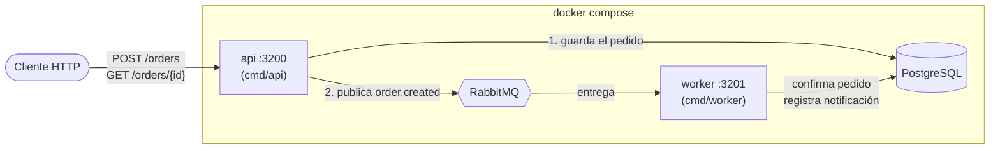
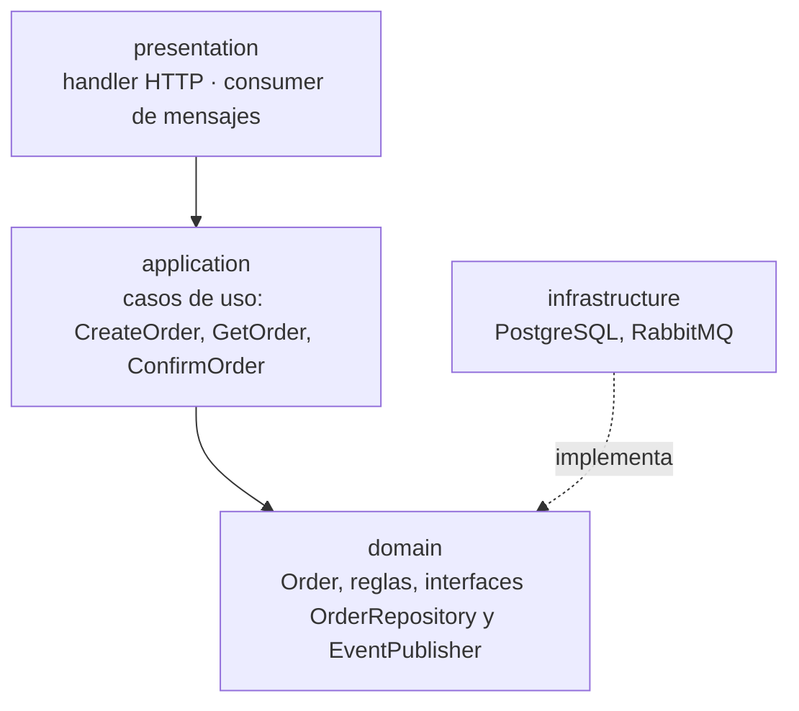
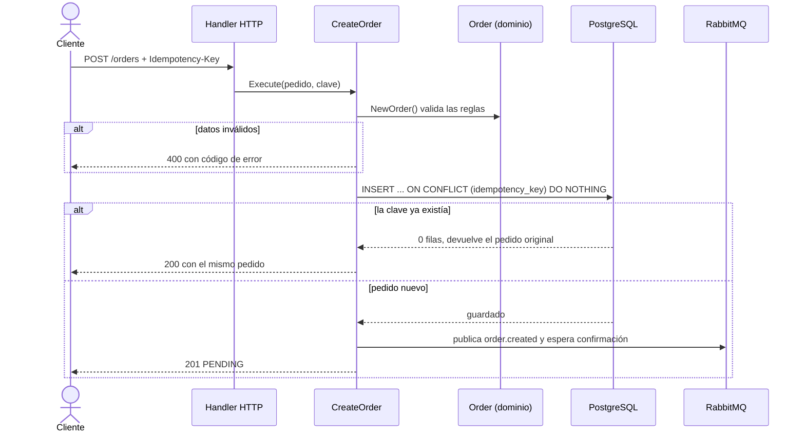
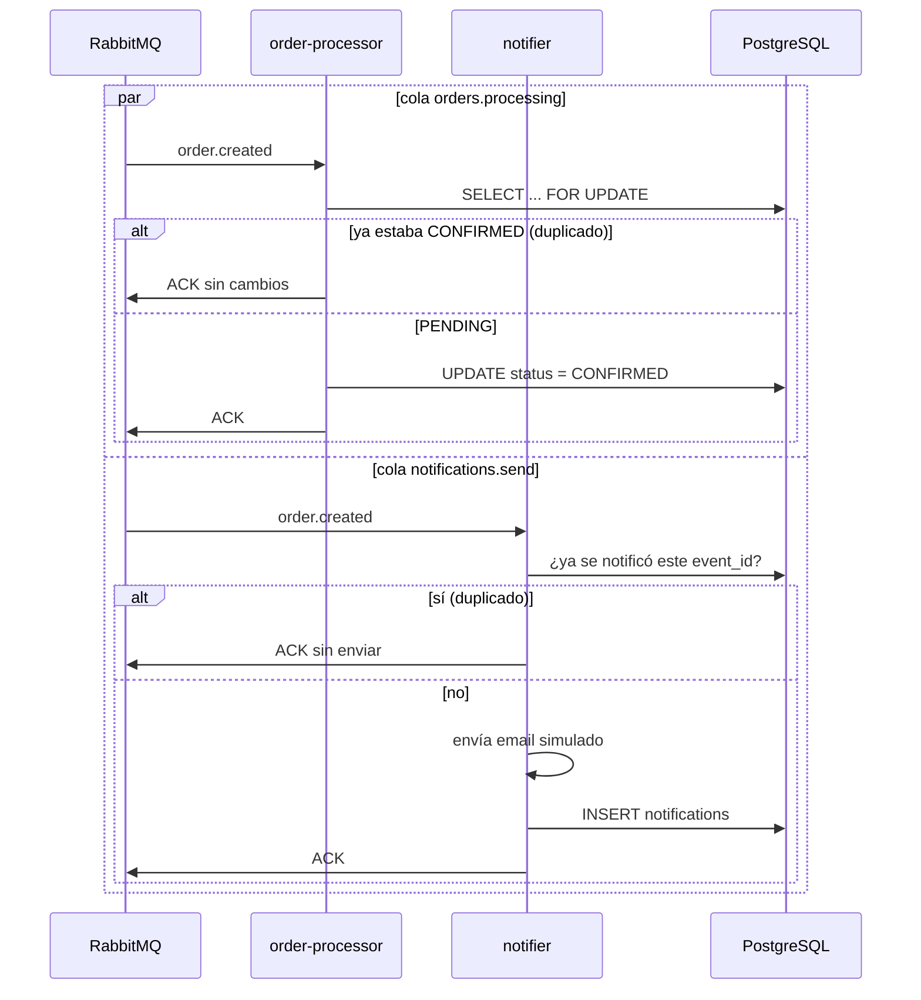
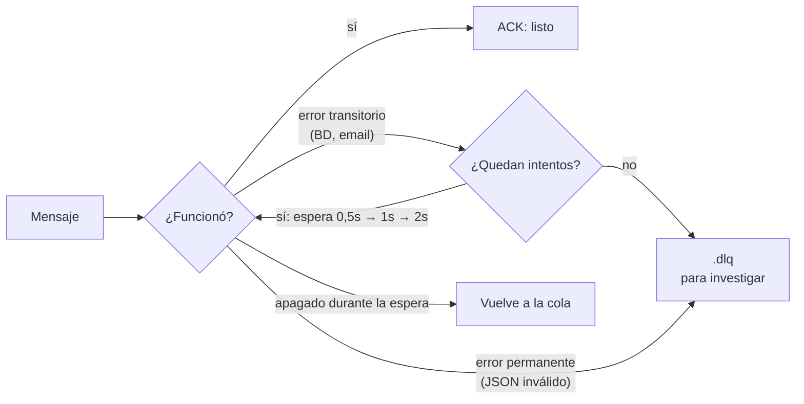
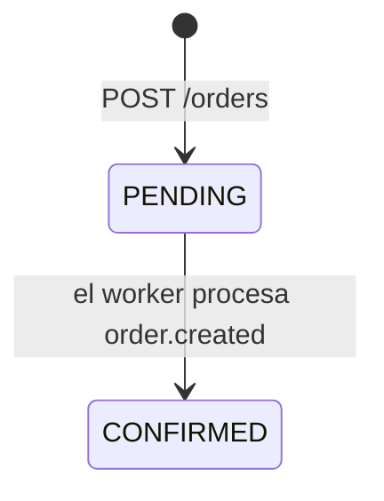
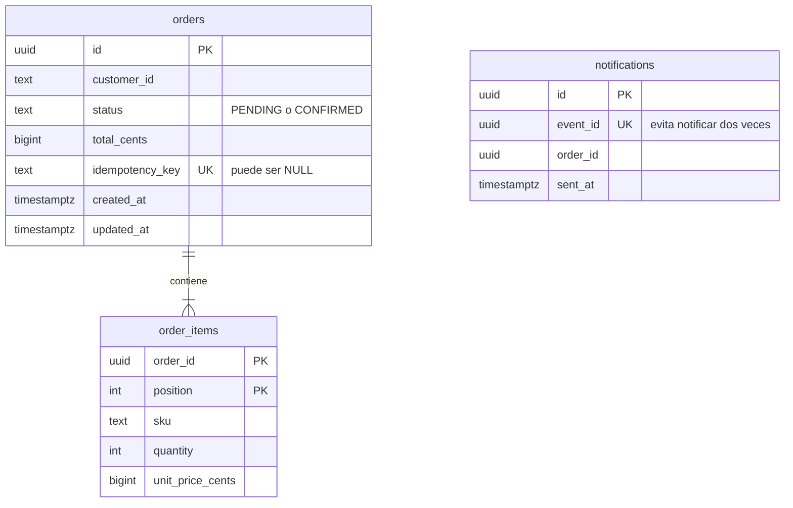
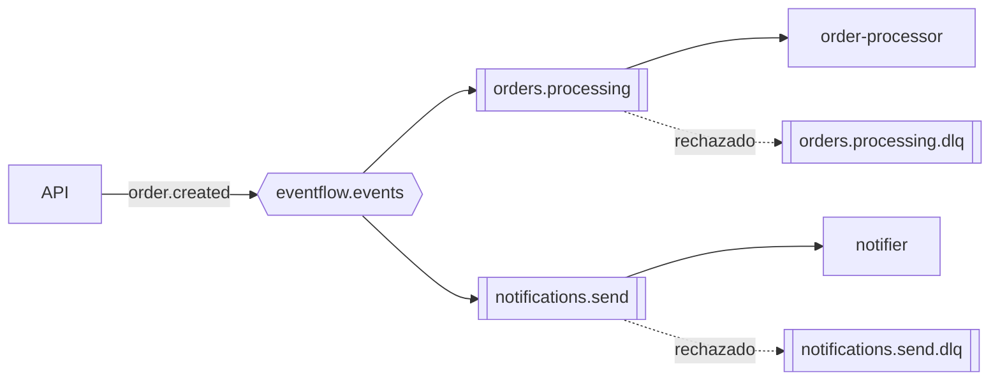

# 4. Arquitectura

> Los diagramas están en [Mermaid](https://mermaid.js.org/). GitHub los dibuja solo. En VS Code se ven con la
> extensión *Markdown Preview Mermaid Support*.

## Componentes



| Componente | Qué hace |
|---|---|
| **API** | Recibe pedidos, los valida, los guarda y publica el evento. Responde sin esperar al worker |
| **Worker** | Dos consumidores: `order-processor` (pasa el pedido a `CONFIRMED`) y `notifier` (email simulado) |
| **PostgreSQL** | Guarda pedidos, artículos y notificaciones enviadas |
| **RabbitMQ** | Transporta los eventos; guarda en una `.dlq` los que no se pudieron procesar |

La API y el worker salen del **mismo código y la misma imagen Docker**, pero corren como dos procesos.

## Capas (como en la semilla)



- **domain** no importa nada externo. Define las reglas y las interfaces que necesita.
- **application** coordina: valida con el dominio, guarda con el repositorio y publica con el publicador.
- **infrastructure** implementa esas interfaces con PostgreSQL y RabbitMQ.
- **presentation** traduce HTTP o mensajes de RabbitMQ en llamadas a los casos de uso.
- `cmd/container` (API) y `cmd/worker/main.go` crean las piezas concretas y las conectan.

## Crear un pedido



## Procesar el evento (worker)



## Reintentos y cola de mensajes muertos



## Estados del pedido



## Base de datos



Las tablas se crean con los archivos de `migrations/`, que se aplican al arrancar y quedan registrados en
`schema_migrations`.

## Colas de RabbitMQ



Formato del evento (`pkg/events/events.go`):

```json
{
  "event_id": "b7a2…",
  "event_type": "order.created",
  "occurred_at": "2026-11-16T12:00:00.123456Z",
  "correlation_id": "9e15… (request_id del POST)",
  "order_id": "4f1c…",
  "customer_id": "customer-42",
  "total_cents": 3999
}
```
